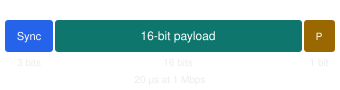
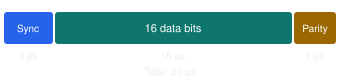
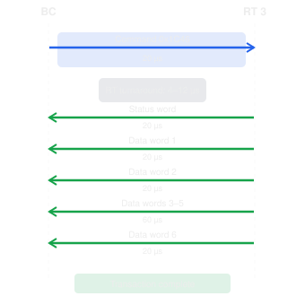

# 1553
MIL_STD_1553 command/response serial communication protocol spawned 40 years ago via the F16 development.
- deterministic
- fault-tolerant
- widely applied in military and space systems

A typical use case is communication between flight computers harware
such as sense or, actuators and the like.

## Highlights
- 1 Mbps
- Logical
  - Bus Controller (BC): Schedules and initiates communication.
  - Remote Terminal (RT): Responds to commands from the controller. Often interfaces to a sensor, actuator, or subsystem.
  - Bus Monitor (BM): Passively observes bus traffic, useful for telemetry, recording, diagnostics, and simulation.
  - All Data Transfers are initiated by the BC
  - Commands
    - BC->RC 
    - RT->BC
    - ?
- Command
  - Response
- A MIL-STD-1553 command word is 16 bits of information, transmitted as 20 bit-times on the wire.


## The wire protocol
Each 1553 word contains 20 transmitted bits:


## 1553 Word


The fields specify:
- RT address: Which terminal is being addressed (0–30 for ordinary RTs; 31 is reserved for broadcast).
- T/R: Whether the terminal transmits or receives.
- Subaddress: Which logical endpoint or buffer is involved.
- Word count: Number of 16-bit data words, from 1 through 32. Zero encodes 32 for ordinary transfers.
  Subaddresses 0 and 31 have special significance for mode commands.


## Time 
At 1 Mbps, each bit occupies 1 microsecond. A complete 1553 word occupies 20 microseconds:


## Consider BC requesting RT for 6 words
```aiignore
RT Address:    00011    (3)
T/R:           1        (Transmit)
Subaddress:    00010    (2)
Word Count:    00110    (6)

Command word:  00011 1 00010 00110
Hex:           0x1C46
```


```aiignore
[RT Address]       --> Which hardware device (e.g., RT 3: IMU)
[T/R Bit]          --> Direction (Receive = Write to RT, Transmit = Read from RT)
[Subaddress]       --> Which functional buffer / mailbox (e.g., Subaddress 1 = Attitude, 0/31 = Mode Code)
[Word Count/Code]  --> Number of 16-bit words (or Mode Code function if subaddress is 0 or 31)
```

Here's what happens:
1. The BC transmits the 20-bit-time command word 0x1C46, taking 20 µs.
2. Every terminal connected to the bus can observe the command, but only RT address 3 is selected to respond.
3. RT 3 decodes the command and recognizes that it has been instructed to transmit six data words from subaddress 2.
4. The BC stops driving the bus. After a response delay of 4–12 µs, RT 3 begins transmitting.
5. RT 3 first transmits a 20-bit-time status word, identifying itself and communicating protocol status.
6. RT 3 then transmits six consecutive 20-bit-time data words.
7. The RT finishes transmitting, and the bus becomes available for the controller's next transaction.


1. The Core Analogy: IP Address vs. Port / Mailbox
   To conceptualize the addressing hierarchy in MIL-STD-1553:
   RT Address (5 bits: 0–31): Like an IP address or hardware ID. It identifies which physical device (LRU / box) on the bus the Bus Controller (BC) is speaking to (e.g., RT 3 = IMU, RT 4 = Reaction Wheel Controller).
   T/R Bit (1 bit): Specifies the direction of data flow:
   0 (Receive / Write): BC sends data to the RT.
   1 (Transmit / Read): RT sends data back to the BC.
   Subaddress (5 bits: 0–31): Like a port number or functional mailbox / memory buffer inside that RT.
   Word Count (5 bits: 1–32 words): Specifies how many 16-bit words to transfer into or out of that mailbox.

2. Standard Data Subaddresses (1 to 30): Functional Mailboxes
   When the subaddress is in the range 1–30 (00001–11110), it directs data to/from a specific software buffer or hardware register inside the subsystem.
   Because each subaddress is paired with the T/R bit, each subaddress effectively provides two distinct logical channels (one for incoming data and one for outgoing data):
   Example: Satellite IMU (RT 3)
   Subaddress 1 + Transmit (T/R = 1): High-rate attitude angles (3 words: Pitch, Roll, Yaw).
   Subaddress 2 + Transmit (T/R = 1): Raw angular rates and accelerations (6 words: \omega_x, \omega_y, \omega_z, a_x, a_y, a_z).
   Subaddress 3 + Transmit (T/R = 1): Health, temperature, and supply voltages (4 words: internal temps, 5V/12V rails).
   Subaddress 4 + Receive (T/R = 0): Calibration offsets and mounting bias matrix sent from flight computer to IMU.
   Example: Reaction Wheel / Motor Controller (RT 4)
   Subaddress 1 + Receive (T/R = 0): Motor torque setpoints / speed commands from Flight Computer.
   Subaddress 1 + Transmit (T/R = 1): Actual wheel speed and motor current feedback.
   Subaddress 2 + Receive (T/R = 0): PID control gain tuning parameters.


3. Special Subaddresses (0 and 31): Mode Codes (Control & Reset)
   Your guess about having commands for "reset", "self-test", and "status" is exactly what Mode Codes are for in MIL-STD-1553B:
   Subaddresses 00000 (0) and 11111 (31) are reserved by the standard.
   When the subaddress is set to 0 or 31, the 5-bit Word Count field is repurposed as a Mode Code (a protocol-level command to control the terminal itself).
   Standard MIL-STD-1553 Mode Codes include:
   Mode Code (in Word Count field)
   Name
   Description
   00001 (0x01)
   Synchronize
   Sync internal clocks / timing without data.
   00010 (0x02)
   Transmit Status Word
   Force the RT to return its status register.
   00011 (0x03)
   Initiate Self-Test
   Triggers internal Built-In-Test (BIT) / diagnostics.
   00100 (0x04)
   Transmitter Shutdown
   Disables redundant bus transmitter if faulty.
   01000 (0x08)
   Reset Remote Terminal
   Resets the RT hardware/software to power-on state.
   10001 (0x11)
   Synchronize (with Data)
   Sync with timestamp / epoch data word.
   10011 (0x13)
   Transmit BIT Word
   Transfers detailed failure/diagnostic codes to the BC.

4. Summary of Message Definition (The ICD)
   In aerospace systems, an Interface Control Document (ICD) maps bus communications using these exact fields:
   [RT Address]       --> Which hardware device (e.g., RT 3: IMU)
   [T/R Bit]          --> Direction (Receive = Write to RT, Transmit = Read from RT)
   [Subaddress]       --> Which functional buffer / mailbox (e.g., Subaddress 1 = Attitude, 0/31 = Mode Code)
   [Word Count/Code]  --> Number of 16-bit words (or Mode Code function if subaddress is 0 or 31)

This separation allows a single Remote Terminal (e.g. an IMU or Flight Computer) to exchange dozens of different types of telemetry, commands, configuration parameters, and diagnostic routines over a single shared twisted-pair bus.